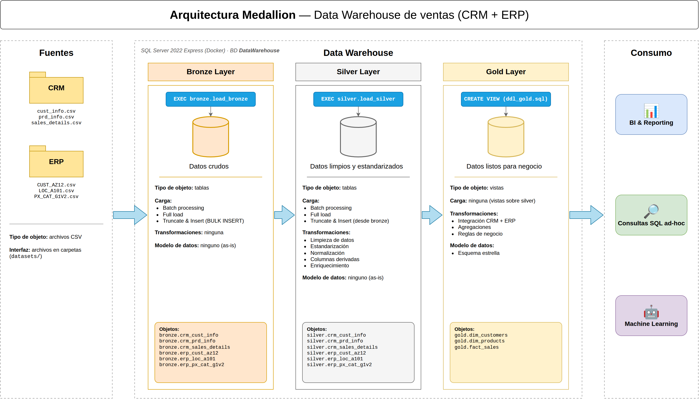

# Data Warehouse de ventas: arquitectura Medallion

Data warehouse en **SQL Server 2022 Express** (Docker) que integra dos sistemas
fuente, **CRM** y **ERP**, en las capas **Bronze → Silver → Gold**.



## Capas

| Capa | Contenido | Objetos |
|---|---|---|
| Bronze | Datos crudos, tal cual vienen de los CSV | Tablas |
| Silver | Datos limpios y estandarizados | Tablas |
| Gold | Modelo estrella listo para negocio | Vistas |

## Cómo ejecutarlo

1. Levantar SQL Server: `docker start sqlserver`
2. Copiar los CSV al contenedor:
   ```bash
   docker exec sqlserver mkdir -p /var/opt/mssql/datasets
   docker cp datasets/source_crm sqlserver:/var/opt/mssql/datasets/
   docker cp datasets/source_erp sqlserver:/var/opt/mssql/datasets/
   ```
3. Ejecutar en orden:
   - `scripts/init_database.sql`
   - `scripts/bronze/ddl_bronze.sql` y `scripts/bronze/proc_load_bronze.sql`, luego `EXEC bronze.load_bronze;`
   - `scripts/silver/ddl_silver.sql` y `scripts/silver/proc_load_silver.sql`, luego `EXEC silver.load_silver;`
   - `scripts/gold/ddl_gold.sql`
4. Validar con `tests/quality_checks_silver.sql` y `tests/quality_checks_gold.sql`.

## Estructura

```
datasets/       CSV de los sistemas fuente (source_crm, source_erp)
docs/           Diagramas, catálogo de datos, tareas y convenciones
scripts/        DDL y procedimientos de carga por capa (bronze, silver, gold)
tests/          Pruebas de calidad de datos
```

## Documentación

- [Tareas y convenciones de nombres](docs/tareas_y_convenciones.md)
- [Catálogo de datos (Gold)](docs/data_catalog.md)

## Integrantes

- García Rangel Miguel Angel
- Pérez Aguiar Oropeza Gabriel Emiliano
